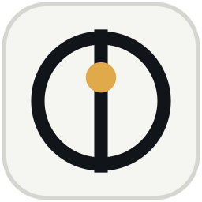
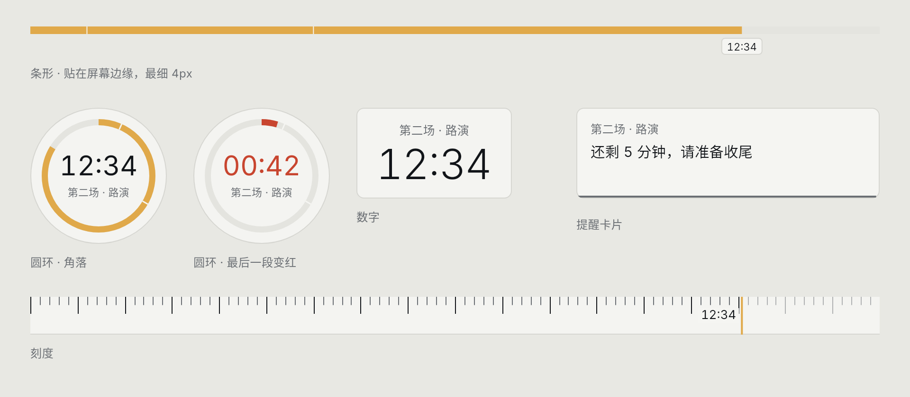
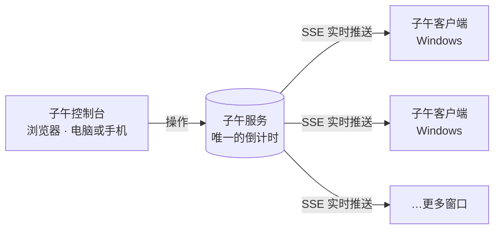
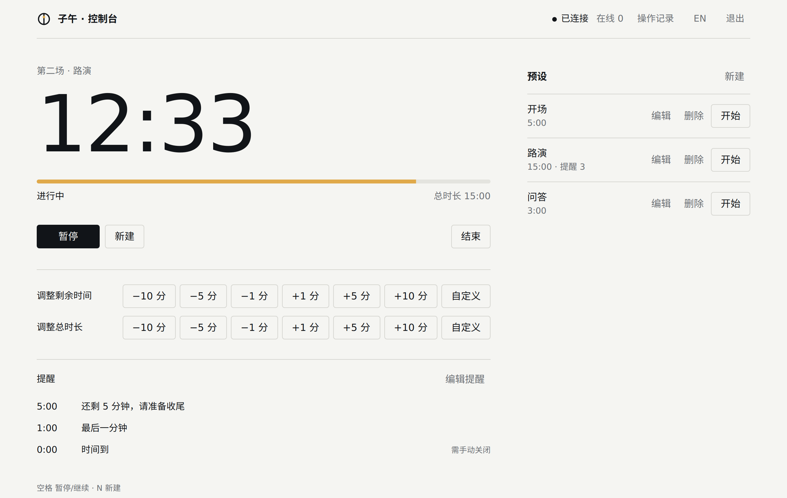

<div align="center">



# Meridian · 子午

**所有窗口，同一个现在。**

一个自部署的倒计时同步工具。<br>
在网页上开始一次倒计时，每一台电脑的屏幕边缘都会同时出现同一个剩余时间。

[](https://github.com/YuKiBi0/Meridian/releases/latest) [](https://github.com/YuKiBi0/Meridian/actions/workflows/ci.yml) [](https://github.com/YuKiBi0/Meridian/actions/workflows/client-windows.yml) [](LICENSE)

[下载客户端](https://github.com/YuKiBi0/Meridian/releases/latest) · [部署服务](docs/DEPLOYMENT.md) · [产品需求](docs/PRD.md) · [设计理念](docs/DESIGN.md) · [参与开发](docs/DEVELOPMENT.md)

</div>

<br>

<picture>
  <source media="(prefers-color-scheme: dark)" srcset="docs/images/client-dark.png">
  
</picture>

## 它解决什么

答辩、考试、直播、路演……需要一群人看着同一个倒计时的时候，子午让这件事变得简单：

- **一处操作，处处同步。** 服务器上只有一个倒计时。操作者在浏览器里开始、暂停、加减时间，所有连上的窗口同时跟着变。
- **不挡事。** 客户端贴在屏幕边缘、置顶、可以鼠标穿透，最细只有一条 4px 的线，PPT 照常放。
- **到点提醒。** 「还剩 5 分钟，请准备收尾」会在设定的时刻弹到每个人的屏幕上。
- **走时准确。** 客户端用本地单调时钟推算剩余时间，不依赖系统时钟；断线时继续走，重连后以服务器为准。

| 场景 | 怎么用 |
| --- | --- |
| 答辩 / 演讲 | 讲者电脑顶部贴一条细细的进度条，剩 5 分钟时弹出提醒，超时显示 `+01:23` |
| 考场 | 监考用手机打开控制台，各教室投影显示大号数字；临时延长 10 分钟，所有教室同时更新 |
| 直播 | 导播控制，主播屏幕角落放一个圆环；插播时暂停，回来继续 |
| 比赛 / 黑客松 | 用预设快速切换「开场 5 分钟」「路演 3 分钟」「问答 2 分钟」 |

## 怎么工作



| 程序 | 给谁用 | 说明 |
| --- | --- | --- |
| **子午服务** | 部署者 | 一个 Go 程序加 PostgreSQL，控制台已内置；Docker Compose 一条命令启动 |
| **子午控制台** | 操作者 | 网页，电脑和手机都能用；开始、暂停、加减时间，管理预设和提醒 |
| **子午客户端** | 观看者 | Windows 桌面程序；只负责显示，选样式、摆位置 |

## 快速开始

**1. 部署服务。** 准备一台有 Docker 的服务器：

```sh
cp deploy/.env.example deploy/.env      # 填入数据库密码与控制台口令
docker compose --env-file deploy/.env -f deploy/docker-compose.yml up -d --build
```

再配好 nginx 反向代理。完整步骤见 **[部署文档](docs/DEPLOYMENT.md)**。

**2. 打开控制台。** 访问 `https://<你的域名>/meridian/`，用口令登录。

**3. 安装客户端。** 从 [Releases](https://github.com/YuKiBi0/Meridian/releases/latest) 下载 `Meridian-windows-x64.zip`，解压后运行 `meridian.exe`，填入服务器地址 `https://<你的域名>/meridian`。

支持 Windows 10 1809 及以上、Windows 11（x64）。

## 控制台

<picture>
  <source media="(prefers-color-scheme: dark)" srcset="docs/images/console-dark.png">
  
</picture>

**新建一次倒计时**：点「新建」（或按 `N`），填时长、标题、提醒，然后「开始」；也可以「保存预设」以后一键开始。

| 时长写法 | 含义 |
| --- | --- |
| `15` | 15 分钟 |
| `1:30` | 1 分 30 秒 |
| `1:30:00` | 1 小时 30 分 |

**到时行为**：「停在零」显示 `00:00` 并停住；「计超时」在归零后显示 `+MM:SS` 继续往上数，直到结束或延长。

**进行中**：

- **暂停 / 继续**：按钮或空格键。
- **调整剩余时间**：−10 / −5 / −1 / +1 / +5 / +10 分钟，或自定义。只改剩余，总时长不变。
- **调整总时长**：同上，但剩余和总长一起加减，进度条比例随之变化。
- **提前到时**：把剩余减到 0，计时立即进入「时间到」（会先确认）。
- **编辑提醒**：随时增删改这一轮的提醒。已经过去的时间点不会再弹。
- **结束**：结束这一轮（会先确认）。

**提醒**：每条提醒包含「剩余多少时弹出」「提示内容」「显示多久」，也可以设成需要手动关闭。

**多人同时操作**：所有控制台通过同一条实时连接同步。两个人同时按下时，后到的操作会被拒绝并提示刷新；同时编辑提醒时，后保存的一方会被提示先载入最新内容，不会互相覆盖。

**快捷键**：`空格` 暂停 / 继续 · `N` 新建 · `Esc` 关闭弹层。

## 客户端

### 四种样式

| 样式 | 放在哪 | 可调 |
| --- | --- | --- |
| **条形** | 屏幕上 / 下 / 左 / 右边缘，铺满整条边 | 粗细 4 / 8 / 16 / 32px，可显示剩余时间 |
| **圆环** | 四个角，或拖到任意位置 | 直径 96 / 144 / 200 |
| **数字** | 四个角、上中、下中，或拖到任意位置 | 字号小 / 中 / 大，可显示标题 |
| **刻度** | 屏幕上 / 下边缘 | 高度 24 / 40px |

进行中进度为琥珀色（可在设置里换色）；进入最后一段变为朱红：一般是最后 60 秒，5 分钟以内的倒计时是最后 20%；暂停或未开始时退为灰色。提醒点在进度上画成细刻痕。

### 操作

- **右键**窗口，或点**托盘图标**：切换样式、贴边位置、窗口置顶、鼠标穿透，打开设置。
- **双击**窗口：打开设置。
- **拖动**圆环或数字：自由摆放；拖到离屏幕边缘 24px 以内会自动贴上去。
- **悬停**托盘图标：显示「标题 · 剩余时间」或连接状态。

### 设置

| 分类 | 选项 |
| --- | --- |
| 连接 | 服务器地址 |
| 样式 | 样式与各自的尺寸、是否显示剩余时间 / 标题 / 提醒刻痕 |
| 贴边 | 位置、边距 0 / 8 / 16px、显示在哪块屏幕 |
| 窗口 | 置顶、鼠标穿透、开机启动、不透明度 40% ~ 100% |
| 外观 | 浅色 / 深色 / 跟随系统、进度颜色（8 种预设或自定义十六进制）、中文 / English |

### 提醒卡片

到点时，提醒会以卡片形式出现在计时器旁边，不调用系统通知、不抢焦点。卡片底部的细线表示还会显示多久；点击或「知道了」关闭。开启了鼠标穿透时，卡片区域会临时可以点击。

### 托盘图标

图标上竖线中间的那个点表示状态：空心为未连接，实心为已连接但没在走，琥珀色（或你选的进度颜色）为进行中，朱红为最后一段或时间到。

## 文档

| 文档 | 内容 |
| --- | --- |
| [部署](docs/DEPLOYMENT.md) | Docker Compose、nginx 反向代理、环境变量 |
| [产品需求](docs/PRD.md) | 完整的功能需求、状态机、接口与协议、数据模型 |
| [设计理念](docs/DESIGN.md) | 用词、配色、字体、动效与各个决定背后的理由 |
| [开发](docs/DEVELOPMENT.md) | 本地运行、测试与构建 |
| [发版](docs/RELEASING.md) | 版本号与节气代号、发版脚本、部署与回滚 |

## 名字

子午线是一条人为约定的线，让不同地方的人共享同一个「现在」。子午做的也是这件事：让每个窗口都统一现在是几点。

版本代号按二十四节气排列，1.0 是**小满**：可用、够用，不贪多。

## 许可

[MIT](LICENSE) © 2026 YuKiBi0
