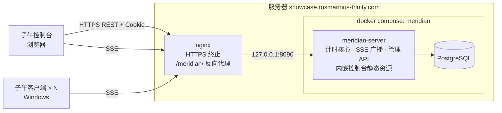
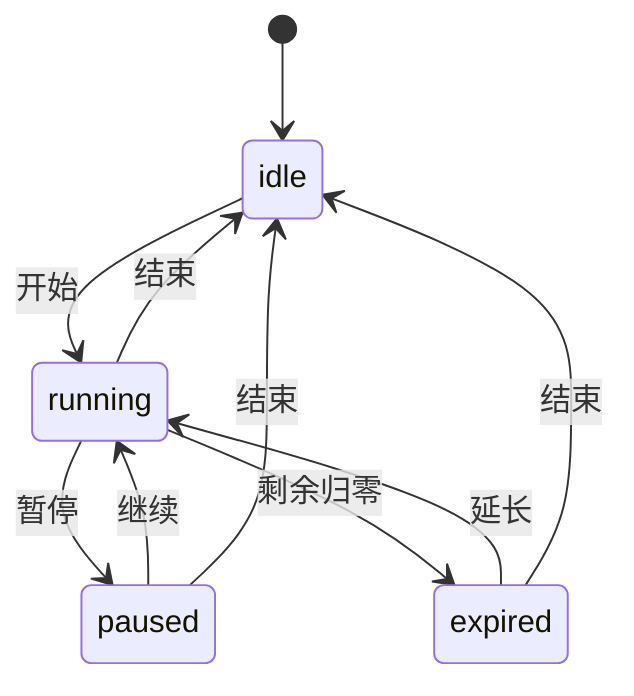

# 子午 · 产品需求文档（PRD）

> 所有窗口，同一个现在。

| 项目 | 内容 |
| --- | --- |
| 文档版本 | v1.0（据初版构想整理） |
| 更新日期 | 2026-10-17 |
| 配套文档 | [DESIGN.md](./DESIGN.md)（命名、视觉、文案） |
| 部署地址 | `https://showcase.rosmarinus-trinity.com/meridian` |
| 状态 | 已确认，进入开发 |

需求编号规则：`SRV-` 服务端，`CON-` 控制台，`CLI-` 客户端，`NFR-` 非功能。
优先级：**P0** 1.0 必须有；**P1** 1.0 应该有；**P2** 1.0 之后。

---

## 1. 背景与目标

### 1.1 问题

考场、会议、演讲、直播、比赛里，经常需要多块屏幕显示**同一个**倒计时：主持人要延时、要暂停，所有屏幕得同时跟上。现有做法是每台电脑各开一个计时器手动对齐，或者共享一块屏幕，都不准，也不方便。

### 1.2 产品

一个自部署的倒计时同步系统：

- **子午服务**（Go）持有若干「房间」，每个房间一个倒计时，通过 SSE 把状态推给房间里的所有人。
- **子午控制台**（网页）给操作者开始、暂停、延长、结束倒计时，管理预设和提醒。
- **子午**（Flutter Windows 客户端）只填一个房间地址就能显示该房间的倒计时，可以贴在屏幕边缘、保持置顶，收到提醒时弹出自绘卡片。

### 1.3 目标

| # | 目标 | 衡量方式 |
| --- | --- | --- |
| G1 | 所有窗口显示同一个剩余时间 | 同网络下任意两个客户端显示的秒数在 99% 的时间相同 |
| G2 | 操作立即生效 | 控制台点击到客户端画面变化，P95 ≤ 300ms（公网） |
| G3 | 客户端零配置 | 首次使用只需输入一个地址；从安装到看见倒计时 ≤ 30 秒 |
| G4 | 不挡事 | 贴边、置顶、鼠标穿透；运行中平均 CPU < 1% |
| G5 | 一条命令部署 | `docker compose up -d` 后，配一段反向代理即可使用 |

### 1.4 非目标（1.0 不做）

- 账号体系、多租户、权限分级。控制台只有一个管理口令。
- 多路并行倒计时：1.0 不做；1.1 起以「房间」提供，见 D-11。
- 正计时 / 秒表（「超时」计数除外）。
- 移动端、macOS、Linux 客户端（Flutter 可以以后再扩）。
- 系统通知中心通知、提示音。
- 客户端反向控制倒计时。
- 订阅端（SSE）鉴权。倒计时信息不是敏感信息。

---

## 2. 用户与场景

### 2.1 角色

| 角色 | 用什么 | 做什么 |
| --- | --- | --- |
| 操作者 | 子午控制台（浏览器，电脑或手机） | 开始、暂停、延长、结束；维护预设和提醒 |
| 观看者 | 子午客户端（Windows） | 只看。选样式、摆位置 |
| 部署者 | 服务器 + Docker | 部署、配置口令、配反向代理 |

### 2.2 典型场景

1. **答辩 / 演讲**：讲者电脑顶部贴一条 8px 的条形进度，不挡 PPT。剩 5 分钟时弹出「还剩 5 分钟，请准备收尾」。超时后显示 `+01:23`。
2. **考场**：监考在手机上打开控制台，各教室投影电脑显示大号数字。临时延长 10 分钟（延长总时长），所有教室同时更新。
3. **直播**：导播控制，主播屏幕右上角一个圆环。中途插播时暂停，回来后继续。
4. **比赛 / 黑客松**：用预设快速切换「开场 5 分钟」「路演 3 分钟」「问答 2 分钟」。

---

## 3. 系统总览

### 3.1 架构



### 3.2 组件与技术选型

| 组件 | 选型 | 理由 |
| --- | --- | --- |
| 服务端 | Go（标准库 `net/http`，`log/slog`），单二进制 | 轻量；SSE 用标准库即可；`embed` 打包控制台 |
| 数据库 | **PostgreSQL 17**，驱动 `pgx/v5` | 持久化预设、当前计时、操作记录；与服务一同用 compose 部署 |
| 数据库迁移 | SQL 文件 `embed` 进二进制，启动时按版本号顺序执行 | 不引入额外工具，部署零步骤 |
| 控制台 | Vue 3 + Vite + TypeScript，不用组件库 | 产物小（< 200KB）、原生文字渲染、手机可用、内网无外网也能用；视觉完全按 DESIGN.md 手写 |
| 客户端 | Flutter（Windows 桌面） | 需求指定；自绘 UI 灵活 |
| 客户端插件 | `window_manager`、`screen_retriever`、`tray_manager`、`shared_preferences`、`http`、`launch_at_startup` | 无边框透明窗口、置顶、穿透、多屏、托盘、开机启动 |
| 部署 | Docker 多阶段构建 + docker compose；宿主机 nginx 反向代理 | 需求指定 |

为什么控制台不用 Flutter Web：Flutter Web 默认从 CDN 加载 CanvasKit 和中文字体，考场、内网等无外网环境会出问题；产物数 MB，手机上首屏慢。控制台是表单为主的页面，普通网页更合适。

### 3.3 仓库结构

```
meridian/
├── server/                    # 子午服务（Go）
│   ├── cmd/meridian-server/   # 入口
│   ├── internal/timer/        # 状态机、调度、提醒触发（纯逻辑，可单测）
│   ├── internal/stream/       # SSE 广播
│   ├── internal/api/          # HTTP 路由、鉴权、处理函数
│   ├── internal/store/        # PostgreSQL 持久化、迁移
│   └── internal/web/          # embed 控制台构建产物
├── console/                   # 子午控制台（Vue），内部代号 Observatory
├── client/                    # 子午客户端（Flutter），内部代号 Astrolabe
├── deploy/                    # compose、nginx 示例
├── docs/                      # PRD.md、DESIGN.md
├── Dockerfile
└── README.md
```

### 3.4 分支与提交

- `main`：发布分支；`develop`：日常集成分支。
- 每个大功能从 `develop` 拉 `feature/<name>`，完成后通过 PR 合回 `develop`。
- 每个小阶段完成即提交一次，提交信息说明做了什么。
- 发布时 `develop` 合入 `main` 并打 tag（`v0.1.0` 等），release 标题带节气代号。

---

## 4. 核心概念

| 概念 | 定义 |
| --- | --- |
| 房间（Room） | 一路独立的倒计时。有唯一的 `id`（UUIDv7）和一个「房间名」；房间名可以重复，只用于辨认，与倒计时的「标题」无关。服务上可以有多个房间同时计时 |
| 计时（Timer） | 房间里唯一的倒计时。每个房间任一时刻只有一个 |
| 一轮（Run） | 从「开始」到「结束」的一次倒计时，有唯一 `run_id`。再次开始即新的一轮 |
| 总时长 `total` | 进度条的满格长度 |
| 剩余 `remaining` | 还剩多少时间。进度 = remaining / total |
| 超时 `overtime` | 剩余归零后继续正向计数的时间（仅当预设选择「到时后计超时」） |
| 预设（Preset） | 一组可复用配置：名称、标题、总时长、提醒、到时行为。所有房间共用 |
| 提醒（Reminder） | 剩余时间降到某个点时，向所有客户端推一张卡片 |
| 序号 `seq` | 状态版本号，每次状态变化 +1，单调递增，每个房间各自计数。客户端丢弃旧版本 |

---

## 5. 计时状态机

### 5.1 状态

| 状态 | 代码值 | 界面用词 | 说明 |
| --- | --- | --- | --- |
| 未开始 | `idle` | 未开始 | 没有进行中的一轮 |
| 进行中 | `running` | 进行中 | 剩余时间在减少 |
| 已暂停 | `paused` | 已暂停 | 剩余时间冻结 |
| 时间到 | `expired` | 时间到 | 剩余为 0；若开启超时，超时在增加 |

「已结束」不是一个状态，而是 `idle` 携带的 `last_end` 信息：客户端据此显示「已结束」5 秒，再回到「未开始」。

### 5.2 状态图



### 5.3 操作 × 状态

| 操作 | idle | running | paused | expired |
| --- | --- | --- | --- | --- |
| 开始 | ✓ | ✓ 需确认，旧一轮按「结束」处理 | 同左 | 同左 |
| 暂停 | — | ✓ | — | — |
| 继续 | — | — | ✓ | — |
| 结束 | — | ✓ 需确认 | ✓ 需确认 | ✓ |
| 延长剩余时间 | — | ✓ | ✓ 仍保持暂停 | ✓ → running |
| 延长总时长 | — | ✓ | ✓ 仍保持暂停 | ✓ → running |
| 减少时间（剩余 / 总时长） | — | ✓ | ✓ 仍保持暂停；减到 0 → expired | — |
| 修改提醒 | — | ✓ | ✓ | — |

不允许的操作返回 `409 invalid_state`。

### 5.4 延长规则

设延长量为 Δ（1 秒 ~ 24 小时）。

| 模式 | running / paused | expired |
| --- | --- | --- |
| 延长剩余时间 | remaining += Δ；若 remaining > total，则 total = remaining | remaining = Δ，total 不变（若 Δ > total 则 total = Δ）；超时清零 |
| 延长总时长 | total += Δ，remaining += Δ | total += Δ，remaining = Δ；超时清零 |

- 延长后，所有「提醒点 < 新剩余」且已触发过的提醒重新待触发。
- 进度条在客户端以 240ms 匀速补回（DESIGN 5.6）。

**减少时间**（Δ 同样 1 秒 ~ 24 小时，仅 running / paused）：

| 模式 | 规则 |
| --- | --- |
| 减少剩余时间 | remaining = max(remaining − Δ, 0)，total 不变 |
| 减少总时长 | remaining = max(remaining − Δ, 0)，total −= Δ（不低于 1 秒） |

- 被跳过的提醒点（> 新剩余）记为已触发，**不补发**；恰好落在新剩余上的照常触发。
- 剩余减到 0 即提前到时：进入 `expired`（`overtime` 模式从 0 开始正向计数），0 秒提醒照常触发。暂停中减到 0 也一样。

### 5.4.1 修改当前一轮的提醒

running / paused 时可整体替换提醒列表，约束同 5.6（以当前 total 为准）：

- 提醒点 > 当前剩余的（已经过去的）记为已触发，不会再提醒；
- 提醒点 ≤ 当前剩余的，到点时提醒（包括原本已触发、被改到剩余之内的）；
- 提醒的 `id` 保留与否不影响上述判断。
- 多个控制台同时编辑：保存时带上打开编辑时的 `reminders_seq`。期间别人已改过提醒（或开始了新一轮）则拒绝保存，编辑框提示「提醒刚被其他控制台改过」并可「载入最新」。暂停、加减时间等其他操作不影响正在编辑的提醒。

### 5.5 到时行为

每一轮有 `on_expire`：

- `stop`（默认）：剩余归零，显示 `00:00`，状态 `expired`，不再计数。
- `overtime`：剩余归零后显示 `+MM:SS` 继续正向计数，直到被结束或延长。

服务端不会自动结束一轮；`expired` 一直保持到操作者结束或延长。

### 5.6 取值约束

| 字段 | 范围 |
| --- | --- |
| 总时长 | 1 秒 ~ 24 小时 |
| 标题 | 0 ~ 40 字 |
| 提醒数量 | 每轮 / 每个预设最多 20 个 |
| 提醒点 | 0 ≤ at < total；同一轮内不重复 |
| 提示内容 | 1 ~ 80 字，最多 2 行 |
| 提醒显示时长 | 3 ~ 60 秒，默认 8 秒；或「需手动关闭」 |
| 预设数量 | 最多 100 个 |

---

## 6. 功能需求：服务端

| 编号 | 需求 | 优先级 |
| --- | --- | --- |
| SRV-01 | 实现第 5 节状态机。时间计算用 Go 单调时钟（`time.Now()` 自带），不受系统时间调整影响 | P0 |
| SRV-02 | 用一个调度 goroutine 管理「下一个事件」（下一个提醒点或归零），用 `time.Timer` 精确唤醒，不轮询 | P0 |
| SRV-03 | 剩余时间下降穿过提醒点时，向所有订阅者广播 `reminder` 事件；每轮每个提醒最多触发一次（延长后重置，见 5.4） | P0 |
| SRV-04 | SSE 订阅端点：连接建立后立即发送一次完整 `state`；之后每次状态变化发送 `state`；每 15 秒发送 `sync` 心跳 | P0 |
| SRV-05 | 管理 API（第 9.3 节），需管理口令 | P0 |
| SRV-06 | 预设增删改查、排序 | P0 |
| SRV-07 | 状态持久化到 PostgreSQL：每次状态变化写入该房间的计时（每个房间一行）。重启后恢复：running 状态按记录的墙钟结束时间重算剩余；若停机期间已归零，恢复为 `expired`；停机期间跨过的提醒不补发 | P0 |
| SRV-08 | 所有路由挂在可配置的基础路径下（`MERIDIAN_BASE_PATH`，本项目为 `/meridian`） | P0 |
| SRV-09 | 内嵌并托管控制台静态资源；基础路径下的 `/` 返回控制台 | P0 |
| SRV-10 | 健康检查 `GET {base}/healthz`（含数据库连通性）；二进制支持 `meridian-server healthcheck` 子命令，供无 shell 的镜像使用 | P0 |
| SRV-11 | 按房间统计在线订阅数（区分客户端和控制台，按 `?role=` 参数），管理 API 可查询 | P1 |
| SRV-12 | 管理操作支持 `if_seq` 乐观并发：带上时若与当前 `seq` 不符返回 `409 seq_conflict`，避免两个控制台互相覆盖 | P1 |
| SRV-13 | 操作记录：每次管理操作写一条记录（时间、操作、参数、来源 IP），保留最近 1000 条，可查询 | P1 |
| SRV-14 | 登录限流：每 IP 每分钟最多 5 次失败尝试 | P1 |
| SRV-15 | 预设导入 / 导出（JSON） | P2 |
| SRV-16 | 房间：新建、重命名、删除，最多 100 个。每个房间有自己的计时、`seq` 与持久化，互不影响。删除时结束其计时，向房间里的订阅者发送 `room_deleted` 后断开 | P0 |
| SRV-17 | 订阅与公开接口用 `?r=<房间 id>` 指定房间；房间不存在时返回 `404 room_not_found`。提供公开的 `GET {base}/api/v1/rooms/{id}`，供客户端加入前确认房间存在 | P0 |
| SRV-18 | 升级时把 1.0 的唯一计时迁移为一个名为「默认房间」的房间，进行中的一轮不中断 | P0 |

---

## 7. 功能需求：控制台

页面标题：`子午 · 控制台`（英文 `Meridian · Console`）。地址：`https://showcase.rosmarinus-trinity.com/meridian/`。

### 7.1 页面

**登录页**：一个输入框「管理口令」，一个按钮「进入」。口令错误时提示「口令不对」。

**房间列表**（登录后的首页）：每个房间一行，显示房间名、剩余时间、状态、标题与在线客户端数，时间实时走动；可「新建房间」「重命名」「删除」「进入」。新建后直接进入该房间。

**房间页**（地址为 `{控制台地址}?r=<房间 id>`，可收藏、可后退；单页，宽屏左右两栏，窄屏上下堆叠，最窄支持 360px）。顶部是「← 全部房间」和房间名，右栏最上方是「客户端地址」与「复制」：

```
┌───────────────────────────────────────────────────────────────┐
│ 子午 · 控制台                     ● 已连接   在线 12    退出  │
├───────────────────────────────────────────────────────────────┤
│ ← 全部房间   一号厅                                            │
├──────────────────────────────────────┬────────────────────────┤
│                                      │ 客户端地址              │
│                                      │ [https://…?r=0192…][复制]│
│  第二场 · 路演                        │ 预设             [新建] │
│                                      │ ───────────────────────│
│            12:34                     │ 开场        5:00   开始 │
│  ████████████████░░░░░░░░  总 15:00  │ 路演       15:00   开始 │
│  进行中                               │ 问答        3:00   开始 │
│                                      │                        │
│  [暂停]                     [结束]    │                        │
│                                      │                        │
│  调整剩余时间 [−10][−5][−1][+1][+5][+10] [自定义]              │
│  调整总时长   [−10][−5][−1][+1][+5][+10] [自定义]              │
│  ────────────────────────────                                │
│  提醒                                  [编辑提醒]              │
│  14:00  开场提醒              已过                             │
│   5:00  还剩 5 分钟                                            │
│                                      │                        │
│  [新建]                               │                        │
└──────────────────────────────────────┴────────────────────────┘
```

### 7.2 需求

| 编号 | 需求 | 优先级 |
| --- | --- | --- |
| CON-01 | 登录：输入管理口令，成功后写入 HttpOnly Cookie，30 天有效；「退出」清除 | P0 |
| CON-02 | 实时状态：订阅同一个 SSE 流，显示标题、剩余（大号等宽数字）、总时长、进度条、状态文字，与客户端同一套计算和视觉 | P0 |
| CON-03 | 新建：时长输入支持 `15`（分钟）、`1:30`（分:秒）、`1:30:00`（时:分:秒）；可填标题、提醒列表、到时行为；可「开始」也可「保存预设」 | P0 |
| CON-04 | 开始 / 暂停 / 继续 / 结束。按钮只显示当前状态下可用的操作。结束需确认：「结束后无法继续。确定结束？」 | P0 |
| CON-05 | 正在计时时开始新一轮需确认：「当前计时会被结束。确定开始？」 | P0 |
| CON-06 | 调整时间：两行按钮分别对应「调整剩余时间」「调整总时长」，各含 −10 / −5 / −1 / +1 / +5 / +10 分、自定义（自定义里选延长或减少）。两行分开放，不用模式开关，避免误用模式。减少会让剩余归零时需确认：「剩余时间将归零，计时会立即到时。确定？」（5.4） | P0 |
| CON-07 | 预设列表：开始、编辑、删除（需确认）、拖拽排序 | P0 |
| CON-08 | 提醒编辑：每条提醒包含「剩余多少时提醒」「提示内容」「显示时长 / 需手动关闭」；可增删；保存时校验 5.6 约束，违反时就地提示 | P0 |
| CON-09 | 连接状态显示（已连接 / 连接中 / 未连接），断线自动重连 | P0 |
| CON-10 | 键盘快捷键：空格 暂停/继续；`N` 新建；`Esc` 关闭弹层 | P1 |
| CON-11 | 显示在线客户端数 | P1 |
| CON-12 | 带 `if_seq` 发送操作；冲突时提示「状态已被其他控制台改动，已刷新」 | P1 |
| CON-13 | 操作记录页 | P1 |
| CON-14 | 中英文界面，跟随浏览器语言，可手动切换 | P1 |
| CON-15 | 浅色 / 深色，跟随系统 | P1 |
| CON-16 | 预设导入导出 | P2 |
| CON-18 | 多控制台同步：同一房间的状态经该房间的 SSE 流实时同步；预设变动经 `presets` 事件同步到所有控制台；同时编辑提醒时后保存者被拒绝并提示载入最新（5.4.1） | P1 |
| CON-19 | 房间列表：新建（填房间名，可重名）、重命名、删除（需确认：「删除房间「X」？房间里的计时会结束，已连接的客户端会退回输入地址的界面。」）、进入；列表经 `rooms` 事件实时刷新 | P0 |
| CON-20 | 房间页：所有计时操作只作用于当前房间；显示该房间的「客户端地址」（控制台地址加 `?r=`），可一键复制 | P0 |
| CON-21 | 当前房间被删除（`room_deleted`，或重连时发现房间已不存在）时回到房间列表并提示「这个房间已被删除」 | P0 |
| CON-17 | 当前一轮的提醒列表：显示提醒点、内容，已过的标「已过」；running / paused 时可「编辑提醒」，增删改后立即生效（5.4.1） | P0 |

---

## 8. 功能需求：客户端

窗口标题：`子午`（英文 `Meridian`）。平台：Windows 10 1809+ / Windows 11，x64。

### 8.1 连接

| 编号 | 需求 | 优先级 |
| --- | --- | --- |
| CLI-01 | 首次启动显示连接页：一个输入框「房间地址」（占位文字 `https://example/meridian?r=…`），一个按钮「连接」。地址从控制台房间页的「客户端地址」复制。连接前先请求 `GET {地址}/api/v1/rooms/{id}` 确认房间存在，存在才加入；不存在时提示「这个房间不存在。检查地址，或在控制台复制最新的客户端地址。」 | P0 |
| CLI-02 | 地址规范化：缺少协议时补 `https://`；去掉末尾 `/`；若用户粘贴了完整的 `/api/v1/stream` 地址也能识别；`?r=` 取房间 id（UUID，大小写不敏感），缺少时提示「地址里缺少房间号。在控制台进入房间，复制那里的客户端地址。」。订阅地址 = `{地址}/api/v1/stream?role=client&r={id}` | P0 |
| CLI-03 | 地址保存在本地，之后启动自动连接，不再显示连接页。房间被删除（收到 `room_deleted`，或重连时得到 `404 room_not_found`）时停止重连，回到连接页并提示「这个房间已被删除。填写新的房间地址。」；1.0 保存的不带房间的地址同样回到连接页 | P0 |
| CLI-04 | 断线自动重连，退避 1s → 2s → 4s … 上限 30s；连接中状态见 DESIGN 5.7 | P0 |
| CLI-05 | 连不上时提示：「连不上这个地址。检查地址是否正确，或服务器是否在运行。」 | P0 |
| CLI-07 | 设置页「房间」一栏显示房间名（随控制台重命名更新）与房间地址；样式与提醒卡片仍显示倒计时的标题 | P0 |
| CLI-06 | 延迟补偿：连接后调用 `GET {地址}/api/v1/time` 3 次，取最小往返时间的一半作为单程延迟，从收到的剩余时间中扣除 | P1 |

### 8.2 走时与同步

| 编号 | 需求 | 优先级 |
| --- | --- | --- |
| CLI-10 | 收到 `state` 时记录锚点（服务端剩余、本地单调时钟读数）；显示值 = 锚点剩余 − 自锚点起经过的单调时间。不使用系统墙钟 | P0 |
| CLI-11 | 丢弃 `seq` 小于当前的 `state` | P0 |
| CLI-12 | 收到 `sync` 时，若本地推算与服务端差值 > 100ms，以服务端为准重设锚点 | P0 |
| CLI-13 | 断线期间按最后状态继续走时（含本地归零进入「时间到」/超时），重连后以服务端为准 | P0 |
| CLI-14 | 按需重绘：只在显示内容会变化时重绘（下一个秒边界，或进度条下一个像素），不以 60fps 常驻刷新 | P0 |
| CLI-15 | 检测休眠恢复（两帧间隔 > 5 秒）：立即重连并重新同步 | P1 |

### 8.3 样式

四种样式，详见 DESIGN 3.4 和 5.7。

| 编号 | 样式 | 贴边位置 | 可调项 | 优先级 |
| --- | --- | --- | --- | --- |
| CLI-20 | 条形 | 上 / 下 / 左 / 右（横贴满宽，竖贴满高） | 粗细 4 / 8 / 16 / 32px；是否显示剩余时间文字（显示在进度末端） | P0 |
| CLI-21 | 圆环 | 左上 / 右上 / 左下 / 右下 | 直径 小 96 / 中 144 / 大 200 | P0 |
| CLI-22 | 数字 | 四角 + 上中 / 下中；或自由摆放 | 字号 小 / 中 / 大；是否显示标题 | P0 |
| CLI-23 | 刻度 | 上 / 下 | 高度 24 / 40px | P1 |
| CLI-24 | 提醒点在条形、圆环、刻度上画成细刻痕 | — | 可关 | P2 |

### 8.4 窗口

| 编号 | 需求 | 优先级 |
| --- | --- | --- |
| CLI-30 | 无边框、透明背景窗口，贴边时不在任务栏显示 | P0 |
| CLI-31 | 贴边：按样式可选位置贴到屏幕边缘，使用工作区（不压住任务栏），可设边距 0 / 8 / 16px | P0 |
| CLI-32 | 自由摆放：可拖动；拖到离边缘 24px 以内时自动贴上去 | P1 |
| CLI-33 | 窗口置顶，默认开启 | P0 |
| CLI-34 | 置顶守护：前台窗口切换或每 5 秒重新确认一次置顶，避免被其他置顶窗口（如演示软件）压住 | P1 |
| CLI-35 | 鼠标穿透：窗口不挡鼠标，默认关闭；开启后只能从托盘关闭 | P1 |
| CLI-36 | 不透明度 40% ~ 100% | P1 |
| CLI-37 | 多显示器：可选显示在哪块屏幕；该屏幕拔掉时回到主屏幕；DPI 或分辨率变化时重新贴边 | P1 |
| CLI-38 | 浅色 / 深色 / 跟随系统 | P0 |
| CLI-39 | 中文 / English / 跟随系统 | P1 |
| CLI-40 | 开机启动 | P1 |
| CLI-41 | 进度颜色：8 种预设（琥珀为默认，另有松绿、青瓷、天青、靛蓝、藤紫、胭脂、苔绿），也可输入 6 位十六进制自定义；只影响进行中的进度填充与托盘图标的点，警示段仍为朱红 | P1 |

### 8.5 托盘与菜单

| 编号 | 需求 | 优先级 |
| --- | --- | --- |
| CLI-50 | 托盘图标，按状态变化（DESIGN 5.8） | P0 |
| CLI-51 | 托盘菜单与窗口右键菜单一致：样式 ▸、贴边 ▸、窗口置顶 ✓、鼠标穿透 ✓、设置…、关于、退出 | P0 |
| CLI-52 | 设置在同一窗口中打开（窗口临时离开贴边，居中显示 420×600 的设置面板，关闭后回到原位置） | P0 |
| CLI-53 | 悬停托盘图标显示「标题 · 剩余时间」或连接状态 | P1 |

### 8.6 提醒卡片

| 编号 | 需求 | 优先级 |
| --- | --- | --- |
| CLI-60 | 收到 `reminder` 后在客户端窗口内绘制卡片，不调用 Windows 通知 API | P0 |
| CLI-61 | 窗口临时向屏幕内侧扩展以容纳卡片（顶部条形向下、右侧条形向左、角落圆环向屏幕中心），卡片消失后恢复原尺寸 | P0 |
| CLI-62 | 卡片内容：标题（小号、灰）、提示内容；底部一条细线表示剩余显示时间。提醒点 ≤ 警示阈值或为 0 时，细线用朱红 | P0 |
| CLI-63 | 点击卡片或「知道了」关闭；「需手动关闭」的提醒不自动消失 | P0 |
| CLI-64 | 同时最多叠 3 张，更多时移除最早的一张 | P1 |
| CLI-65 | 显示卡片不抢焦点（不激活窗口）；鼠标穿透开启时卡片区域临时可点 | P1 |
| CLI-66 | 断线期间错过的提醒不补发 | P0 |

### 8.7 关于页

显示图标、产品名、版本号与节气代号（`v0.1 · 立春`）、DESIGN 4.1 的那段话、项目地址。

### 8.8 本地设置项

存于 `shared_preferences`：房间地址（含 `?r=`）、房间名、样式、各样式的贴边位置与尺寸、显示器、边距、窗口置顶、鼠标穿透、不透明度、外观、语言、开机启动、自由摆放时的位置。

---

## 9. 接口与协议

基础路径 `{base}` = `/meridian`。完整地址示例：`https://example/meridian/api/v1/stream?r=0192f3a4-5b6c-7d8e-9fa0-b1c2d3e4f506`。

房间 id 是小写的 UUIDv7（接口接受大写）。

所有时间量以毫秒整数表示，字段以 `_ms` 结尾；时间点为 Unix 毫秒。

### 9.1 SSE：`GET {base}/api/v1/stream`

查询参数：

- `r`：房间 id，必填。缺少时 `400 room_required`，房间不存在时 `404 room_not_found`（都在开始推送之前返回 JSON 错误）。
- `role=client|console`：用于在线统计，以及只发给控制台的 `presets` 事件；默认 `client`。

`role=console` 且不带 `r` 时订阅的是**房间列表**：不发 `state`，只发 `rooms` 与 `presets`，心跳为注释行 `: ping`。

响应头：

```
Content-Type: text/event-stream; charset=utf-8
Cache-Control: no-cache, no-transform
Connection: keep-alive
X-Accel-Buffering: no
```

连接建立时先发送 `retry: 2000`，随后立即发送一次 `room` 和一次 `state`。

**`room`**：房间信息，连接时发送一次，重命名时再发送。不带 `id`。

```
event: room
data: {"id":"0192f3a4-5b6c-7d8e-9fa0-b1c2d3e4f506","name":"一号厅","created_at":"2026-10-18T10:00:00Z"}
```

**`room_deleted`**：房间被删除。随后服务端断开连接；客户端不再重连。

```
event: room_deleted
data: {"id":"0192f3a4-5b6c-7d8e-9fa0-b1c2d3e4f506"}
```

**`rooms`**：只发给房间列表的订阅者。房间有新建、重命名、删除，或任一房间状态变化时发送，数据为 `{}`；控制台收到后重新拉取列表。

**`state`**：状态完整快照，每次变化发送。

```
id: 42
event: state
data: {"seq":42,"run_id":"r_01JB8K...","status":"running","title":"第二场 · 路演","total_ms":900000,"remaining_ms":754120,"overtime_ms":0,"on_expire":"stop","marks_ms":[300000,60000],"server_time":1792224000123,"last_end":null}
```

| 字段 | 类型 | 说明 |
| --- | --- | --- |
| `seq` | int | 状态版本 |
| `run_id` | string \| null | 当前一轮；`idle` 时为 null |
| `status` | `idle` \| `running` \| `paused` \| `expired` | |
| `title` | string | 可为空 |
| `total_ms` | int | `idle` 时为 0 |
| `remaining_ms` | int | 服务端发送时刻的剩余 |
| `overtime_ms` | int | 服务端发送时刻的超时 |
| `on_expire` | `stop` \| `overtime` | |
| `marks_ms` | int[] | 各提醒点（用于 CLI-24 画刻痕） |
| `reminders` | object[] | 当前一轮的提醒（Reminder 加 `fired`：已触发或已跳过），按提醒点从大到小；控制台用来展示和编辑，客户端可忽略 |
| `reminders_seq` | int | 提醒最后一次被设置（开始一轮或修改提醒）时的 `seq`；修改提醒时回传，防止互相覆盖（5.4.1）。服务重启后重置 |
| `server_time` | int | 服务端发送时刻 |
| `last_end` | object \| null | `{"run_id":"…","at":1792224000123}`，仅在 `idle` 且刚结束时出现 |

**`reminder`**：提醒触发。不带 `id`（`id` 只用于状态版本）。

```
event: reminder
data: {"seq":42,"run_id":"r_01JB8K...","reminder_id":"m_2","at_ms":300000,"title":"第二场 · 路演","text":"还剩 5 分钟，请准备收尾","duration_ms":8000,"sticky":false}
```

**`presets`**：预设有增删改或调整顺序。只发给 `role=console` 的订阅者，数据为 `{}`（流不需要登录，所以不带预设内容）；控制台收到后重新拉取列表。断线重连后控制台也会重新拉取一次。

**`sync`**：心跳，每 15 秒一次，不带 `id`。

```
event: sync
data: {"seq":42,"status":"running","remaining_ms":740118,"overtime_ms":0,"server_time":1792224015125}
```

客户端用 `seq` 判断心跳是否对应当前状态；不对应时忽略。

### 9.2 公开 REST

| 方法 | 路径 | 说明 |
| --- | --- | --- |
| GET | `{base}/api/v1/rooms/{id}` | `{"id":"…","name":"一号厅"}`；不存在时 `404 room_not_found`。客户端加入前用它确认房间存在 |
| GET | `{base}/api/v1/state?r={id}` | 返回该房间与 `state` 事件相同的 JSON |
| GET | `{base}/api/v1/time` | `{"server_time":1792224000123}`，用于延迟测量 |
| GET | `{base}/healthz` | `200 {"status":"ok"}`；数据库不可用时 `503` |

### 9.3 管理 REST

所有 `{base}/api/v1/admin/*` 需要鉴权：Cookie `meridian_session`（控制台），或请求头 `Authorization: Bearer <管理口令>`（脚本）。写操作只接受 `Content-Type: application/json`（配合 `SameSite=Strict` 防 CSRF）。

| 方法 | 路径 | 请求体 | 说明 |
| --- | --- | --- | --- |
| POST | `/admin/login` | `{"token":"…"}` | 成功设置 Cookie（Path=`{base}`），`204` |
| POST | `/admin/logout` | — | 清除 Cookie |
| GET | `/admin/session` | — | `200` 已登录 / `401` |
| GET | `/admin/rooms` | — | Room 列表，按创建时间 |
| POST | `/admin/rooms` | `{"name":"一号厅"}` | 新建，`201` + Room |
| GET | `/admin/rooms/{id}` | — | Room |
| PUT | `/admin/rooms/{id}` | `{"name":"…"}` | 重命名 |
| DELETE | `/admin/rooms/{id}` | — | 删除，`204` |
| POST | `/admin/rooms/{id}/timer/start` | `{"preset_id":"…"}` 或 `{"total_ms":900000,"title":"…","on_expire":"stop","reminders":[…]}`；可加 `"if_seq"` | 开始新一轮 |
| POST | `/admin/rooms/{id}/timer/pause` | `{"if_seq":42}`（可选） | |
| POST | `/admin/rooms/{id}/timer/resume` | 同上 | |
| POST | `/admin/rooms/{id}/timer/end` | 同上 | |
| POST | `/admin/rooms/{id}/timer/extend` | `{"delta_ms":300000,"mode":"remaining"\|"total","if_seq":42}` | |
| POST | `/admin/rooms/{id}/timer/reduce` | 同上，`delta_ms` 为要减少的量（正数） | 见 5.4 |
| PUT | `/admin/rooms/{id}/timer/reminders` | `{"reminders":[…],"if_reminders_seq":40}` | 替换当前一轮的提醒，见 5.4.1；`if_reminders_seq` 与当前 `reminders_seq` 不符时返回 `409 reminders_conflict` |
| GET | `/admin/presets` | — | 按排序返回 |
| POST | `/admin/presets` | Preset（无 id） | 新建 |
| PUT | `/admin/presets/{id}` | Preset | 修改 |
| DELETE | `/admin/presets/{id}` | — | 删除 |
| PUT | `/admin/presets/order` | `{"ids":["…","…"]}` | 排序 |
| GET | `/admin/logs?limit=100` | — | 操作记录，房间操作带 `room_id` 与当前的 `room_name`（房间已删除时为空） |

计时类操作成功时返回 `200` + 该房间最新的 `state`。

**Room**

```json
{
  "id": "0192f3a4-5b6c-7d8e-9fa0-b1c2d3e4f506",
  "name": "一号厅",
  "created_at": "2026-10-18T10:00:00Z",
  "clients": 12,
  "state": {"seq": 42, "status": "running", "title": "第二场 · 路演", "…": "…"}
}
```

`clients` 是房间里在线的客户端数，`state` 与 `state` 事件相同。房间名 1 到 40 字，可以重复。

**Preset**

```json
{
  "id": "p_01JB8K...",
  "name": "路演",
  "title": "第二场 · 路演",
  "total_ms": 900000,
  "on_expire": "overtime",
  "reminders": [
    {"id": "m_1", "at_ms": 300000, "text": "还剩 5 分钟，请准备收尾", "duration_ms": 8000, "sticky": false},
    {"id": "m_2", "at_ms": 0, "text": "时间到", "duration_ms": 0, "sticky": true}
  ]
}
```

**错误格式**

```json
{"error": {"code": "invalid_state", "message": "当前状态不能暂停"}}
```

| HTTP | code | 场景 |
| --- | --- | --- |
| 400 | `bad_request` | 参数缺失、越界、违反 5.6 约束、房间名为空或超长、房间超过 100 个 |
| 400 | `room_required` | 订阅或 `state` 没有带 `?r=` |
| 401 | `unauthorized` | 未登录或口令错误 |
| 404 | `not_found` | 预设不存在 |
| 404 | `room_not_found` | 房间不存在或已删除 |
| 409 | `invalid_state` | 当前状态不允许该操作 |
| 409 | `seq_conflict` | `if_seq` 不匹配 |
| 429 | `too_many_attempts` | 登录限流 |
| 500 | `internal` | 其他 |

---

## 10. 数据模型（PostgreSQL）

```sql
-- 预设
CREATE TABLE presets (
  id          TEXT PRIMARY KEY,
  name        TEXT NOT NULL,
  title       TEXT NOT NULL DEFAULT '',
  total_ms    BIGINT NOT NULL CHECK (total_ms BETWEEN 1000 AND 86400000),
  on_expire   TEXT NOT NULL DEFAULT 'stop' CHECK (on_expire IN ('stop','overtime')),
  reminders   JSONB NOT NULL DEFAULT '[]',
  sort        INT NOT NULL DEFAULT 0,
  created_at  TIMESTAMPTZ NOT NULL DEFAULT now(),
  updated_at  TIMESTAMPTZ NOT NULL DEFAULT now()
);

-- 房间
CREATE TABLE rooms (
  id          UUID PRIMARY KEY,              -- UUIDv7，由服务端生成
  name        TEXT NOT NULL,                 -- 可以重复
  created_at  TIMESTAMPTZ NOT NULL DEFAULT now(),
  updated_at  TIMESTAMPTZ NOT NULL DEFAULT now()
);

-- 每个房间当前的计时（每个房间一行，随房间删除）
CREATE TABLE room_timers (
  room_id       UUID PRIMARY KEY REFERENCES rooms (id) ON DELETE CASCADE,
  seq           BIGINT NOT NULL,
  run_id        TEXT,
  status        TEXT NOT NULL,
  title         TEXT NOT NULL DEFAULT '',
  total_ms      BIGINT NOT NULL DEFAULT 0,
  remaining_ms  BIGINT NOT NULL DEFAULT 0,   -- paused / expired 时有效
  ends_at       TIMESTAMPTZ,                 -- running 时的墙钟结束时间，用于重启恢复
  expired_at    TIMESTAMPTZ,                 -- 进入 expired 的墙钟时间，用于恢复超时计数
  on_expire     TEXT NOT NULL DEFAULT 'stop',
  reminders     JSONB NOT NULL DEFAULT '[]',
  fired         JSONB NOT NULL DEFAULT '[]', -- 本轮已触发的提醒 id
  updated_at    TIMESTAMPTZ NOT NULL DEFAULT now()
);

-- 操作记录
CREATE TABLE op_logs (
  id         BIGSERIAL PRIMARY KEY,
  at         TIMESTAMPTZ NOT NULL DEFAULT now(),
  action     TEXT NOT NULL,
  params     JSONB NOT NULL DEFAULT '{}',
  seq_after  BIGINT,
  remote_ip  TEXT,
  room_id    UUID              -- 房间操作所属的房间；房间删除后保留
);

-- 迁移版本
CREATE TABLE schema_migrations (version INT PRIMARY KEY, applied_at TIMESTAMPTZ NOT NULL DEFAULT now());
```

- 运行时以内存为准，数据库是持久层：状态变化先改内存、广播，再异步写库（写库失败记日志并重试，不阻塞广播）。
- 墙钟字段只用于重启恢复，运行时计算一律用单调时钟。
- ID：房间为 UUIDv7；其余为带前缀的随机串（`p_` 预设、`r_` 一轮、`m_` 提醒）。
- 迁移 `0002_rooms` 把 1.0 的 `timer_state` 单行移入一个名为「默认房间」的房间，然后删除 `timer_state`。

---

## 11. 部署

### 11.1 环境变量

| 变量 | 默认 | 说明 |
| --- | --- | --- |
| `MERIDIAN_ADDR` | `:8080` | 监听地址 |
| `MERIDIAN_BASE_PATH` | `` | 基础路径，本项目 `/meridian` |
| `MERIDIAN_DATABASE_URL` | — | 必填，如 `postgres://meridian:***@db:5432/meridian?sslmode=disable` |
| `MERIDIAN_ADMIN_TOKEN` | — | 必填，至少 16 位；未设置时拒绝启动 |
| `MERIDIAN_COOKIE_SECURE` | `true` | 本地开发可设 `false` |
| `MERIDIAN_TRUSTED_PROXY` | `127.0.0.1/32,172.16.0.0/12` | 信任其 `X-Forwarded-For` 的代理网段 |
| `TZ` | `Asia/Shanghai` | 只影响日志 |

### 11.2 docker compose

`deploy/docker-compose.yml`：

- `db`：`postgres:17-alpine`，数据卷 `meridian-pg`，**不映射宿主机端口**，带健康检查。
- `server`：本仓库 `Dockerfile` 构建；`depends_on: db (healthy)`；端口只绑定 `127.0.0.1:8090:8080`；`restart: unless-stopped`。
- 密钥放在 `deploy/.env`（不入库），提供 `deploy/.env.example`。

镜像：多阶段构建（node 构建控制台 → go 构建并 embed → `gcr.io/distroless/static` 非 root 运行），目标体积 < 25MB。

### 11.3 反向代理（宿主机 nginx，宝塔）

新增 `/www/server/panel/vhost/nginx/extension/showcase.rosmarinus-trinity.com/meridian.conf`，并在 `nginx.conf` 中 showcase 的 server 块里 include（与现有 `vibe-engineering.conf` 相同做法）：

```nginx
location = /meridian {
    return 301 https://$host/meridian/;
}
location ^~ /meridian/ {
    if ($scheme = http) {
        return 301 https://$host$request_uri;
    }
    proxy_pass http://127.0.0.1:8090;     # 不剥离前缀，服务端自己处理 /meridian
    proxy_http_version 1.1;
    proxy_set_header Host $host;
    proxy_set_header X-Real-IP $remote_addr;
    proxy_set_header X-Forwarded-For $proxy_add_x_forwarded_for;
    proxy_set_header X-Forwarded-Proto $scheme;
    proxy_set_header Connection "";
    proxy_buffering off;                  # SSE 必须
    proxy_cache off;
    proxy_read_timeout 1h;                # 心跳 15s，留足余量
}
```

注意：必须用 `^~`，否则 server 块里 `~ .*\.(html|js|css)?$` 的正则 location 会截走 `/meridian/assets/*.js`。

### 11.4 发布

- 服务端：`docker compose -f deploy/docker-compose.yml up -d --build`。
- 客户端：GitHub Actions 在 Windows runner 上 `flutter build windows`，产出便携 zip（P0）与安装包（Inno Setup，P1），挂到 GitHub Release。

---

## 12. 非功能需求

| 编号 | 需求 |
| --- | --- |
| NFR-01 | 同步精度：启用延迟补偿时，客户端剩余时间与服务端误差 ≤ 100ms（不含网络抖动） |
| NFR-02 | 操作生效：控制台到客户端画面变化 P95 ≤ 300ms（公网），≤ 100ms（局域网） |
| NFR-03 | 断线走时：断线 1 小时内本地走时误差 ≤ 1 秒 |
| NFR-04 | 服务端容量：1 vCPU / 256MB 下支持 1000 个并发订阅；1000 订阅时常驻内存 < 64MB |
| NFR-05 | 客户端资源：运行中平均 CPU < 1%，内存 < 150MB；冷启动到显示 ≤ 2 秒 |
| NFR-06 | 控制台：JS + CSS 产物 gzip 后 < 200KB；不依赖任何外网资源 |
| NFR-07 | 可用性：服务重启后客户端在退避上限内自动恢复，状态不丢 |
| NFR-08 | 安全：管理口令只存在于环境变量；会话 Cookie 为 HttpOnly + Secure + SameSite=Strict，内容为 HMAC 签名的过期时间戳；口令比较用常量时间 |
| NFR-09 | 可测试：`internal/timer` 不依赖真实时间，时钟可注入，状态机与延长规则 100% 用单测覆盖 |
| NFR-10 | 无障碍：所有文字与背景对比度 ≥ 4.5:1（琥珀只做填充，见 DESIGN 5.2）；支持系统「减少动态效果」 |

---

## 13. 边界情况

| 场景 | 处理 |
| --- | --- |
| 服务重启时正在计时 | 按 `ends_at` 恢复；停机期间已归零则进入 `expired`；跨过的提醒不补发 |
| 服务器系统时间被校正 | 运行时用单调时钟，不受影响；只影响重启恢复 |
| 客户端系统时间被修改 | 客户端只用单调时钟，不受影响 |
| 客户端休眠后唤醒 | 检测到长间隔，立即重连同步（CLI-15） |
| 房间被删除时客户端在线 | 收到 `room_deleted`，停止重连，回到连接页 |
| 客户端离线期间房间被删除 | 重连得到 `404 room_not_found`，同上 |
| 控制台停在已删除的房间 | 回到房间列表并提示；直接打开已删除房间的地址也一样 |
| 1.0 客户端或 1.0 保存的地址（不带 `?r=`） | 服务端返回 `400 room_required`；新客户端回到连接页提示缺少房间号 |
| 两个控制台同时操作 | `if_seq` 冲突返回 409，后操作者刷新后重试 |
| 延长后剩余超过总时长 | 总时长自动抬高到剩余（5.4） |
| 延长后剩余高于已触发的提醒点 | 该提醒重新待触发 |
| 减少时间跳过了提醒点 | 跳过的不补发；减到 0 时 0 秒提醒照常触发 |
| 计时中把提醒改到已经过去的时间点 | 记为已触发，不会立刻弹出 |
| 提醒点 ≥ 总时长 | 保存时拒绝 |
| 反向代理缓冲 SSE | 服务端发送 `X-Accel-Buffering: no`；nginx 配置 `proxy_buffering off` |
| 反向代理空闲超时 | 15 秒心跳 |
| 数据库暂时不可用 | 计时与广播照常（内存为准），写库重试；`healthz` 返回 503；管理端的预设读写返回 500 |
| 显示器被拔掉 | 回到主显示器重新贴边 |
| 任务栏位置 / 自动隐藏变化 | 按工作区重新贴边 |
| 全屏演示软件 | 置顶守护（CLI-34） |
| 客户端地址填错 | 提示并保持在连接页，可修改 |

---

## 14. 里程碑

每次发布按顺序取下一个节气（DESIGN 4.3）。1.0 为小满。

| 版本 | 代号 | 内容 | 验收 |
| --- | --- | --- | --- |
| v0.1 | 立春 | 服务端：状态机、SSE、管理 API、PostgreSQL 持久化、基础路径 | `curl` 开始一轮，两个 `curl -N` 订阅同步看到状态与提醒 |
| v0.2 | 雨水 | 控制台：登录、实时状态、开始/暂停/继续/结束、两种延长、预设与提醒编辑 | 浏览器中完成全部 P0 操作 |
| v0.3 | 惊蛰 | Docker 镜像、compose、nginx；部署到 `showcase.rosmarinus-trinity.com/meridian` | 公网地址可用，SSE 不被缓冲 |
| v0.4 | 春分 | 客户端：连接、走时同步、数字样式、提醒卡片、托盘 | 两台 Windows 同步显示 |
| v0.5 | 清明 | 客户端：条形、圆环样式，贴边，置顶，设置页 | 所有贴边位置正确 |
| v0.6 | 谷雨 | 刻度样式、鼠标穿透、多显示器、不透明度、开机启动、延迟补偿、休眠恢复、置顶守护 | NFR-01 ~ NFR-05 |
| v0.7 | 立夏 | 英文界面、在线数、操作记录、并发冲突、Windows 打包与 Release 流水线 | 全部 P1 |
| v1.0 | 小满 | 稳定性与全量验收 | 全部 P0 / P1 验收通过 |
| v1.1 | 芒种 | 多房间：房间增删改、各自计时，客户端以 `?r=` 加入；1.0 计时迁移为「默认房间」 | SRV-16 ~ 18、CON-19 ~ 21、CLI-01 ~ 03 / 07 |

> 实际进度：v0.4（春分）一次交付了表中 v0.4 ~ v0.6 的客户端功能和 Windows 安装包流水线（v0.7）；之后补上进度颜色、减少时间、计时中编辑提醒、多控制台同步，并在真实 Windows 桌面上验收后发布 **v1.0.0（小满）**。提醒卡片自定义位置曾实现但影响窗口贴边，已撤回，卡片沿用跟随计时器的方式。
>
> 初版构想写的是「v0.1 立春 → v0.5 谷雨 → v1.0 小满」。按「每次发布顺延一格」的规则，中间若有一次修复版本即会出现 v0.5 谷雨；本表按无修复版本排期，实际代号以发布顺序为准。

---

## 15. 决策记录

| 编号 | 决策 | 理由 |
| --- | --- | --- |
| D-1 | 「停止（可再继续）」与「暂停」合并为「暂停」，界面不出现「停止」 | 二者行为相同；违反「一概念一词」 |
| D-2 | 控制台用 Vue 3 网页，内嵌在服务端二进制中 | 见 3.2；一个镜像同时提供 API 与控制台 |
| D-3 | 数据库用 PostgreSQL，随 compose 部署独立实例 | 需求指定；独立实例与宿主机其他服务互不影响 |
| D-4 | 提醒由服务端触发并广播，客户端不自行判断 | 所有窗口同时弹出；断线客户端不会误弹过时的提醒 |
| D-5 | 1.0 只有一个倒计时；1.1 起改为多房间，见 D-11 | 1.0 时需求只要一个；不为假想需求增加复杂度 |
| D-6 | 订阅端不鉴权，管理端用单一口令 | 需求明确订阅无需认证；倒计时信息不敏感 |
| D-7 | 到时后默认停在 `00:00`，超时计数由预设开启 | 多数场景只需知道「到了」；演讲类场景可选 |
| D-8 | 客户端设置面板、提醒卡片都在主窗口内绘制，不开第二个原生窗口 | Flutter Windows 多窗口支持不成熟；单窗口改尺寸更可靠 |
| D-9 | 客户端的窗口定位、置顶、鼠标穿透、不透明度走 runner 内自写的 `meridian/window` 原生通道，不用 `window_manager` 的对应接口 | `window_manager` 置顶时调用 `SetWindowPos` 不带 `SWP_NOACTIVATE`，每 5 秒的置顶守护会把焦点从演示软件抢走；按物理像素定位也避免了混合 DPI 下的换算误差 |
| D-10 | 托盘使用 `tray_manager` 0.5.x | 0.8 是基于 nativeapi 的重写版，尚不成熟 |
| D-11 | 多房间：房间 id 用 UUIDv7，放在查询参数 `?r=` 里；房间名可以重复；预设所有房间共用；订阅仍不鉴权 | 客户端地址就是控制台里复制来的那一串，不用另填房间号；UUIDv7 按时间排序且难以猜到，知道地址即可加入，与 D-6 一致；房间名只为辨认，不必唯一 |
